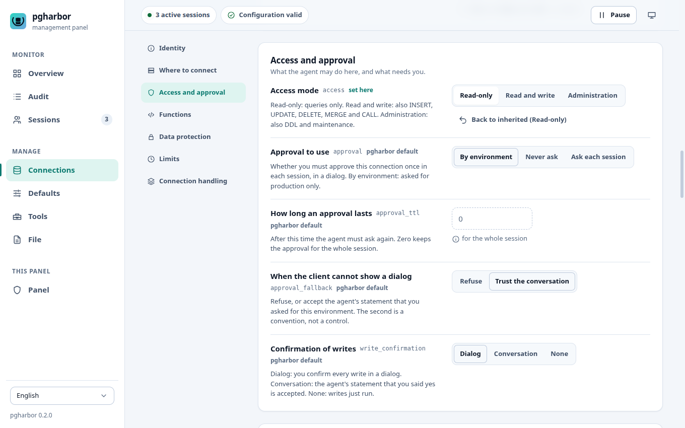
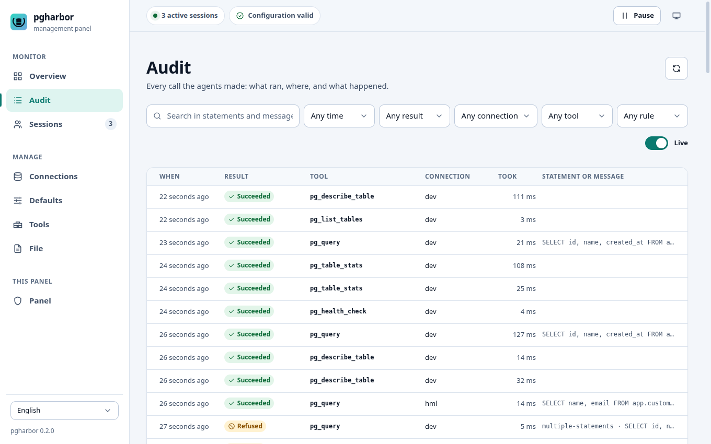
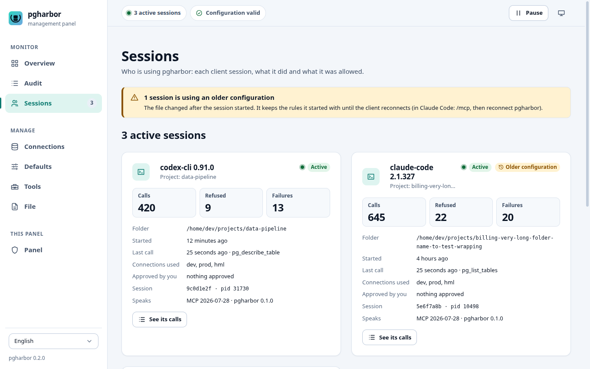
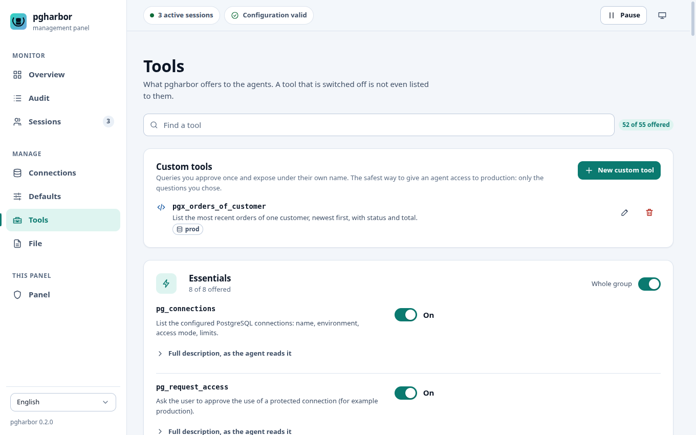
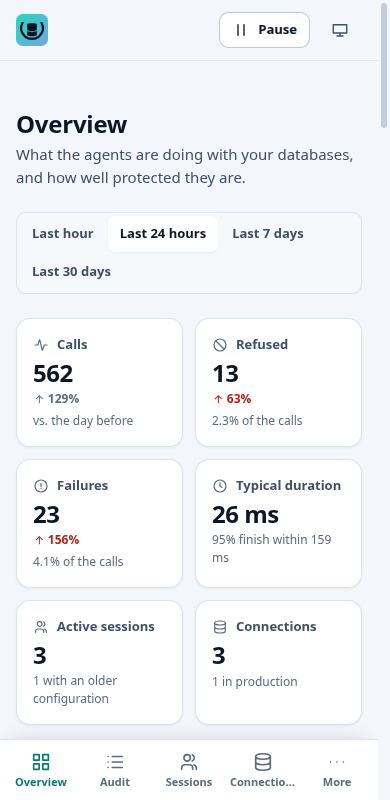
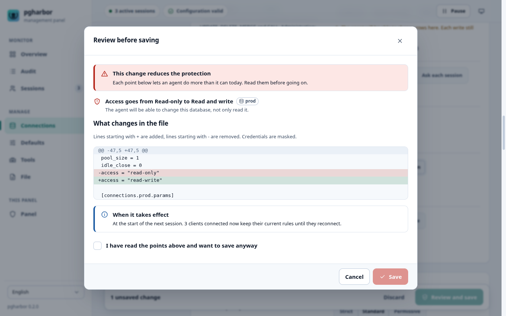

# The management panel

`pgharbor ui` opens a local web page where the owner of an installation sees everything
pgharbor is doing and changes everything pgharbor can be told: who is connected, what was
run, which databases the agents reach and under which rules.

It is a separate program. The MCP server that agents talk to never starts it, never loads
its code and never listens on a port. The panel exists only while the command runs.

<p align="center">
  
  
</p>

- [Starting it](#starting-it)
- [What is on each screen](#what-is-on-each-screen)
- [How a change is saved](#how-a-change-is-saved)
- [When a change takes effect](#when-a-change-takes-effect)
- [The emergency pause](#the-emergency-pause)
- [Sessions: who is using pgharbor](#sessions-who-is-using-pgharbor)
- [Languages and themes](#languages-and-themes)
- [How the panel is protected](#how-the-panel-is-protected)
- [What it cannot do](#what-it-cannot-do)
- [Files it reads and writes](#files-it-reads-and-writes)

## Starting it

```bash
pgharbor ui
```

```text
pgharbor panel is running.

  Open:   http://127.0.0.1:7432/#token=Zk3...

  This address is the key to the panel: do not share it.
  Mode:   editing enabled
  Stops:  after 30 min without use, or with Ctrl+C
```

The browser opens on the panel. The part after `#token=` is a random key, new on every
start; without it the panel answers nothing. The browser is not started with that address
(command lines can be read by other users of the machine) but with a private page that
leads to it and is deleted right after. If your browser cannot read it (some sandboxed
browsers cannot), open the printed address yourself.

Always open the panel from the address the command printed in *your* terminal, never from
a page that asks you to paste that address: once the panel stops, its port is free for
anyone on the machine to take.

| Option | Meaning |
|---|---|
| `--port PORT` | Port on `127.0.0.1`. Default `7432`; `0` picks any free port. |
| `--read-only` | Monitor only: nothing can be changed, not the configuration and not the pause. |
| `--idle-timeout MINUTES` | Stop after this long without use. Default `30`; `0` never stops. |
| `--no-open` | Print the address without opening the browser. |
| `--config FILE` | The configuration file to manage (the same option as every other command). |

The panel counts as "in use" while a tab showing it is visible. Close the tab, or leave it
in the background, and the panel stops by itself after the idle time.

If the page says the key is no longer valid, the panel was restarted: use the address the
new run printed, or paste it into the field on that page.

## What is on each screen

| Screen | What you see | What you can change |
|---|---|---|
| **Overview** | Calls, refusals, failures and typical duration for the last hour, day, week or month, each compared with the period before; calls over time by result; the most used tools; use by connection; refusals by rule; time of day; who is connected; the latest refusals and failures; and the security posture: the [hardening checklist](security.md#hardening-checklist) applied to your configuration. | The period. |
| **Audit** | Every call from the [audit log](configuration.md#audit-log), newest first and updated live: when, result, tool, connection, duration, statement or message. Filter by period, result, connection, tool, rule and session; search the text of statements and messages; open a call to see everything recorded about it. | What the log records (`[audit]`). |
| **Sessions** | One card per running client session: the client and its version, the project folder, when it started, its last call, how many calls were made, refused and failed, which connections it used, which ones you approved and until when, and whether it still runs with an older configuration. Earlier sessions are kept for two weeks. | Nothing: this screen only shows. |
| **Connections** | Every connection with its environment, access mode, server, approval, limits and protected tables, and what the posture check says about it. | Everything in [`[connections.NAME]`](configuration.md#connections): create, edit, rename, duplicate, delete, choose the default connection, and test that a connection works. |
| **Defaults** | The rules and limits every connection inherits. | Everything in `[defaults]`. |
| **Tools** | Every tool pgharbor offers, by group, with the description the agent reads, and why a tool is not listed (switched off, its group is off, or no connection allows writing). | Switch tools and groups on and off (`[tools]`); create, edit and delete [custom tools](configuration.md#custom-tools). |
| **File** | Where the configuration file is, its permissions, whether it is valid and what the validator says; its content, with credentials masked; every earlier version kept by the panel. | Create the starter file; restore an earlier version. |
| **Panel** | Language and theme; version, mode and paths of this run; the emergency pause; how the panel is protected. | Language, theme, the pause; stop the panel. |

<table>
  <tr>
    <td width="50%"></td>
    <td width="50%"></td>
  </tr>
  <tr>
    <td align="center"><sub>Every setting explained, with where its value comes from</sub></td>
    <td align="center"><sub>Every call, live, filtered and searched</sub></td>
  </tr>
  <tr>
    <td width="50%"></td>
    <td width="50%"></td>
  </tr>
  <tr>
    <td align="center"><sub>Who is connected, from which project, and what was approved</sub></td>
    <td align="center"><sub>Tools switched on and off, and custom tools</sub></td>
  </tr>
</table>

<p align="center">
  <br>
  <sub>The same panel on a phone</sub>
</p>

Every setting in the forms shows **where its value comes from**: set in this connection,
inherited from `[defaults]`, or pgharbor's own default. A value that is set can be put
back to the inherited one with one click, which removes the key from the file.

## How a change is saved

Nothing is written when you edit a form. A bar appears with the number of unsaved changes
and one button, **Review and save**, which shows:

1. **Whether the result is valid.** The candidate file is judged by `load_config`, the
   same function the MCP server uses. If it refuses, nothing is written and every problem
   is listed next to its setting.
2. **What it does to the protection.** The panel compares the configuration before and
   after and lists every point where the new one lets an agent do more: access raised,
   approval removed, a protected table or column released (also when a broader rule
   placed before it takes its place), a function vouched for, a tool re-enabled, the
   audit log turned off or moved, a connection added or pointed at another server, user
   or role, an import or export folder changed, a limit raised or removed. A change with
   such a point cannot be saved without ticking "I have read the points above". The
   server enforces this, not the page.
3. **The difference in the file**, line by line, with credentials masked.

<p align="center">
  
</p>

On saving:

- the previous version is copied to a `backups` directory next to the file (the last 30
  are kept);
- the new file replaces the old one in one step, with permissions `600`;
- a line is written to the audit log (`panel.config`), naming the keys that changed,
  never their values.

Comments, the order of the sections and the layout of the file are kept: only the lines of
the settings you changed move. If someone edits the file in a text editor while a form is
open, the save is refused and the page asks you to reload.

**Credentials go in, never out.** A password or a connection string can be defined,
replaced or removed in the panel. One that is already in the file is shown only as
"defined": it is never sent to the browser, never appears in a difference and never in a
backup listing.

## When a change takes effect

**At the start of the next session.** Each MCP client session runs its own pgharbor
process, and a process reads the configuration once, when it starts. A client that is
already connected keeps the rules it started with until it reconnects (in Claude Code:
`/mcp`, then reconnect pgharbor).

The panel tells you which running sessions still use an older version of the file, on the
Sessions screen and in the review before saving.

This is deliberate. Rules that change under a running session are harder to reason about
and to audit, and the one thing that must take effect at once has its own switch.

## The emergency pause

The **Pause** button stops the agents' access to the databases immediately, for every
connection or for the ones you choose, with an optional reason that the agent is shown.

Every running pgharbor checks the pause before each access to a database, so it holds in
every session at once, including the ones that started before it. A paused call is refused
with the rule `paused`, before any approval is asked and before anything reaches the
server. Tools that do not touch a database (`pg_connections`, `pg_audit_log`)
keep answering.

The pause can only take access away. It stays until you end it in the panel, also across
restarts of the panel and of the clients. A paused connection that is renamed stays paused
under both names.

The pause reaches the servers that share the panel's state directory, which are the ones
listed under Sessions. A client that starts pgharbor with a different `XDG_STATE_HOME`
keeps its own state, and neither appears in the panel nor sees its pause.

## Sessions: who is using pgharbor

While it runs, each MCP server process keeps a small file,
`<state directory>/sessions/<id>.json`, and marks every line it writes in the audit log
with the same `session` identifier. That is how the panel links a call to a session.

The file holds the process id, the folder the client started it in, the name and version
the client reported in the MCP handshake, the configuration file it loaded (path and
fingerprint) and the connections you approved. It is refreshed every 15 seconds; a session
whose file stopped being refreshed is shown as "ended without notice".

What a client says about itself is shown, never trusted, and nothing reads these files
back into a server: they describe a session, they cannot change what it may do.

Session files follow `[audit] enabled`: turn the log off and they are not written.

## Languages and themes

English, Brazilian Portuguese and Spanish, chosen in the sidebar (or under **More** on a
phone) and remembered by the browser. The first visit follows the browser's language.

Light and dark themes, or "System" to follow the computer.

The page loads nothing from the network: no fonts, no scripts, no images from elsewhere.

## How the panel is protected

The panel can change which databases an agent reaches, so it is built to be hard to reach.
The full reasoning is in [security.md](security.md#the-management-panel); in short:

| Threat | What answers it |
|---|---|
| Another machine on the network | The panel listens on `127.0.0.1` only. |
| Another user of this computer | They can reach the port but not the key: 256 random bits, new on every start, shown only in your terminal. |
| A web page open in your browser (CSRF) | The key travels in an `Authorization` header, which a foreign page cannot make your browser send, and never in a cookie. Requests that carry no key change nothing. `Origin` and `Sec-Fetch-Site` are checked as well. |
| A foreign name pointed at `127.0.0.1` (DNS rebinding) | Only requests addressed to the panel's own `127.0.0.1:PORT` or `localhost:PORT` are served. |
| Hostile text in the audit log (a statement written by an agent) | The page never parses anything as HTML, and its security policy allows no inline script and nothing from another origin. |
| A slip of the hand | Every save is validated, reviewed, flagged when it weakens the protection, backed up and logged. |
| A panel left running | It stops by itself when no tab is showing it. |

## What it cannot do

- **It does not protect the configuration from a program running as you.** An agent with
  a shell on your machine can edit the file directly, with or without the panel. What
  holds against that is the database role the agent connects with, and a client that asks
  before running commands. The server instructions tell agents that the file and the panel
  belong to the user; that is a request, not a control.
- **It is not reachable from another machine**, and there is no option to make it so. Use
  an SSH tunnel if you manage a remote installation:
  `ssh -L 7432:127.0.0.1:7432 host`, then `pgharbor ui --no-open` there.
- **It does not run queries.** It is not a database client: the only connection it opens
  is the one behind "Test connection".
- **Testing a connection uses the panel's own environment.** If a user name or a password
  comes from an environment variable, the variable must be set in the terminal that
  started the panel, which is not necessarily where the MCP client sets it. The form says
  whether each variable is set where the panel runs.
- **It does not reload running sessions.** See [When a change takes effect](#when-a-change-takes-effect).
- **In the Docker image** the panel would listen inside the container only. Run
  `pgharbor ui` on the host, against the same configuration file.

## Files it reads and writes

| File | Read | Written |
|---|---|---|
| The configuration file (`--config`, `PGHARBOR_CONFIG` or the default path) | yes | on save, replaced in one step |
| `backups/NAME-DATE-TIME-HASH.toml` next to it | yes | one per save, mode `600`, the last 30 kept |
| The audit log | yes | one line per save, pause and connection test |
| `<state directory>/sessions/*.json` | yes | no (the MCP servers write them) |
| `<state directory>/pause.json` | yes | when the pause starts and ends |

The state directory is `$XDG_STATE_HOME/pgharbor` (`~/.local/state/pgharbor` by default;
`%LOCALAPPDATA%\pgharbor` on Windows).
